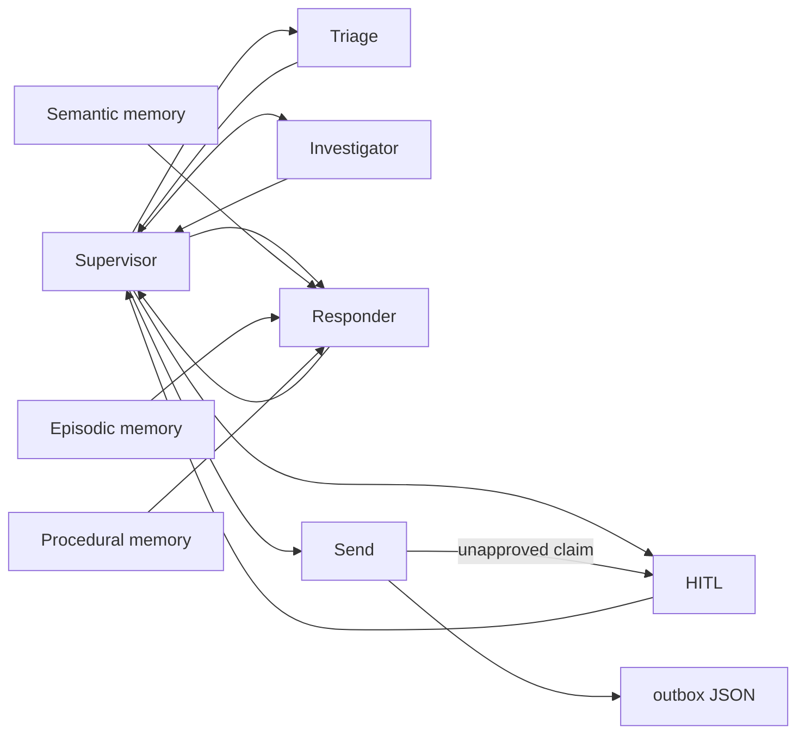
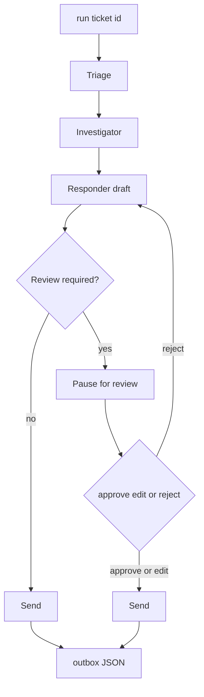

# Ticket triage agent SOP

Use this procedure from the `ticket_triage_agent` directory. Type each command yourself. Do not paste earlier terminal output, or lines that start with `PS`, `>>`, or `+`.

The agent classifies a support ticket, looks up facts, and drafts a reply. It then either pauses for a person or writes one JSON file under `outbox/`. This setup does not send email.

## Agent

The investigator looks up customers, orders, charges, refunds, past tickets, a payment runbook, and knowledge-base articles. It cannot capture, void, or refund a charge. The supervisor is the hub. Triage, the investigator, and the responder each return to it. Human review returns to it after a person answers. The responder reads three memories: knowledge-base articles (semantic), past approved replies (episodic), and the current response rules (procedural). Send writes the outbox file. If the draft makes a flagged or escalating claim that nobody approved, send goes back to review.



Spam, and an escalated run that was not approved, close without a customer reply. An open escalation is recorded in two cases. Approving or editing a reply that promises a specialist writes the outbox file and opens an escalation. A run that was escalated and never sent also opens an escalation, with no customer reply.

## End-to-end flow

`run --ticket-id` starts a new thread every time, so a finished ticket can be run again. Triage, investigation, and the draft happen before the review check. If review is not required, send writes the outbox file. If it is required, the run pauses. Approve or edit sends the reply. Reject sends the draft back to the responder until the revision cap.



A pause is normal. The draft needs a person when any of these are true:

- Priority is P1.
- Triage or draft confidence is under the threshold.
- Sentiment is negative.
- The category is refund, security, or legal.
- The ticket needs a human.
- Investigation did not find the customer or a named order.
- The reply promises that a specialist will follow up.

Those limits live in `.env`.

## Before a live run

```powershell
.\.venv\Scripts\python.exe scripts\run_ticket.py check
```

You want `Missing settings: none`, an embedding model name, and `Memory store is seeded.` The check prints setting names only, not values. Fill `AWS_ACCESS_KEY_ID`, `AWS_SECRET_ACCESS_KEY`, and `AWS_REGION` in `.env`. Chat uses Bedrock Converse. Embeddings use Amazon Titan Text v2 at 1024 dimensions. If the store is missing, was built with the fake embedder, or was built with a different embedding model, delete `data/memory.sqlite` and run this once. Seeding calls Bedrock. Do not delete the store until those AWS values are set, or it cannot be rebuilt.

```powershell
.\.venv\Scripts\python.exe scripts\seed_memory.py
```

Offline tests do not call the model:

```powershell
.\.venv\Scripts\python.exe -m pytest
```

## Run one ticket

Sample tickets are `T-001` through `T-015` in `data/sample_tickets.json`.

```powershell
.\.venv\Scripts\python.exe scripts\run_ticket.py run --ticket-id T-001
```

Read the table. For `T-001`, `paused for review` is the expected stop, not a failure. The route is triage, then investigator, then responder, then review. `sent` stays `no` until you finish the review. The thread id is new each time. It looks like `T-001-` followed by eight characters.

`run --all` calls the model for every sample ticket. Use it only when you mean to process the whole batch. The summary then includes the share handled without a person, the share sent to review, and the share escalated.

## Review

```powershell
.\.venv\Scripts\python.exe scripts\run_ticket.py review
```

The same pause opens in a local page:

```powershell
.\.venv\Scripts\python.exe -m streamlit run scripts/review_app.py
```

Pick a paused run. The page shows the ticket, findings, and draft. Approve sends the draft. Edit sends the text in the reply box. Reject requires feedback. Loading the page does not start a ticket.

## Review on the website

The live review page is [https://ti-afae6cdc673c4b7d9528d45e6076b191.ecs.us-east-1.on.aws/](https://ti-afae6cdc673c4b7d9528d45e6076b191.ecs.us-east-1.on.aws/). Open it, enter the review token, and press Enter. The page then lists paused runs. Pick one. It shows the ticket, findings, and draft. Approve sends the draft. Edit sends the text in the reply box. Reject requires feedback. Do not type a row number on the website. Loading the page does not start a ticket.

The list can be empty. Sample run `T-001-3b7038d4` was already approved, so it is no longer paused. The next `run --ticket-id T-001` creates a new thread and a new pause. An empty list after that approval is the current queue, not a failure.

The graph runs on AgentCore in `us-east-1`. The page runs on ECS Express and calls that runtime. Bedrock still does chat and embeddings. App Runner cannot host this page: its proxy rejects the Streamlit websocket. Paused rows, the outbox, and escalations are copied to a private S3 bucket, so a restarted session still sees them.

## AWS

From `ticket_triage_agent`, after the AWS CLI is logged in:

```powershell
.\.venv\Scripts\python.exe -m pip install bedrock-agentcore-starter-toolkit
.\.venv\Scripts\agentcore.exe configure -e scripts/agentcore_app.py -n ticket_triage -r us-east-1 --deployment-type container --protocol HTTP --non-interactive
.\.venv\Scripts\agentcore.exe deploy
.\.venv\Scripts\agentcore.exe status
```

Use IAM authorization, not OAuth. The runtime name cannot contain a hyphen. The container writes the checkpoint, memory, outbox, and escalations under `/mnt/data`. When `QUEUE_BUCKET` is set, those files are restored from S3 before the graph opens and saved again after `list`, `get`, `run`, and `resume`. Copy the runtime ARN from `agentcore status`. After `.\.venv\Scripts\agentcore.exe deploy`, set `QUEUE_BUCKET` again. A deploy drops it.

Build the review image from `Dockerfile.review` for `linux/amd64` and deploy it with ECS Express in `us-east-1`. Set `AGENT_RUNTIME_ARN`, `AGENT_SESSION_ID`, `REVIEW_TOKEN`, and `AWS_REGION=us-east-1`. `AGENT_SESSION_ID` is one value of at least 33 characters, reused for every call. The task role may call `bedrock-agentcore:InvokeAgentRuntime` on this runtime only. Do not put access keys in either image. Do not write the review token into this file.

The shared queue bucket is `ticket-review-queue-343223593675` in `us-east-1`, prefix `ticket-review/queue/`. It is private. The runtime role may list, get, and put only that prefix.

To check that a restart keeps the queue, list paused tickets with one session id of at least 33 characters, then list again with a different session id. The same paused row should be there. Do not approve, edit, or reject for that check. Two people approving at the same moment can still clash, because both writes land in one sqlite file.

## Finish a review in the terminal

1. Type the number of the row you intend to finish, then Enter. Leave older rows alone.
2. Read the ticket, category, findings, draft, flagged claims, and why it stopped.
3. At `Action [approve/edit/reject]:` type one word.
   - `approve` sends the draft as written.
   - `edit` asks for a new reply. End that reply with a line that is only `.`
   - `reject` requires feedback. The draft goes back to the responder until the revision cap, which stops for review again.
4. At `Feedback (optional):`, press Enter to skip. If you type feedback, answer `y` only when that feedback should become a response rule.

Success is `Sent T-001.` The outbox file for that run is `outbox/` plus the thread id and `.json`. The thread id below is only an example of the shape:

```json
{
  "ticket_id": "T-001",
  "thread_id": "T-001-example",
  "final_reply": "Hi Avery,\n\nThanks for contacting us about the duplicate billing for order 88421. Because this requires a charge reversal, I'm escalating this to a specialist, who will follow up.\n\nSupport Team",
  "sent_at": "2026-10-03T14:11:04.101612Z"
}
```

If that reply promises a specialist, an open escalation file is written for the same thread id.

Approve and edit also store a redacted episodic example. Emails, phone numbers, the customer name, order ids, and amounts are replaced so a later similar ticket can use the reply as a style example.

Feedback saved as a rule appends a procedure version and makes it current. Older versions stay. The next draft loads the current procedure into its system prompt.

## Rules and escalations

```powershell
.\.venv\Scripts\python.exe scripts\run_ticket.py rules
.\.venv\Scripts\python.exe scripts\run_ticket.py rules rollback 1
.\.venv\Scripts\python.exe scripts\run_ticket.py escalations
```

`rules` lists procedure versions. The current one is marked. `rules rollback 1` points the current version at version 1 and does not delete later text. `escalations` lists open escalation files. Those are unsent escalated runs, and approved replies that promised a specialist.

## On-call alerts

`INC-401` is not a ticket in this agent. Classify it only from the `oncall_agent` directory:

```powershell
cd ..\oncall_agent
..\ticket_triage_agent\.venv\Scripts\python.exe scripts\run_alert.py --alert-id INC-401
```

`scripts\run_alert.py` does not exist inside `ticket_triage_agent`.
