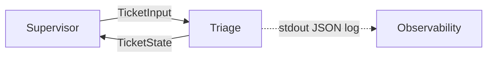

# Triage Agent Plan

Confirmed before implementation. This session adds the initial project files and the Triage Agent only. Supervisor, Investigator, Responder, HITL, and Send are not built here.

## How this session fits the system

The system is a supervisor pattern in Python. A Supervisor will later receive each ticket and route to the next agent from that agent's status. Nodes, in pipeline order: Triage, Investigator, Responder, HITL (when severity is high), Send.

This session is item one only:

- LangChain structured output inside Triage
- LangGraph is reserved for the Supervisor session. It is not imported or scaffolded now
- No Supervisor, Investigator, Responder, HITL, or Send package, graph, or stub

Initial files:

- `triage_agent_plan.md` — this plan
- `README.md` — short map of the supervisor pattern and the statement that only Triage exists so far
- `pyproject.toml` — Python package metadata and pytest config
- `triage_agent/` — the Triage package and its tests

The repo also contains sample data under `data/support`, `data/it-helpdesk`, and `data/oncall`. Those taxonomies use different categories and P1–P4 severities. Triage does not import them. Its enums are the contract below.

## 1. Input schema (`TicketInput`)

Defined in `triage_agent/schemas.py`. The Supervisor passes only this object. No globals and no Supervisor imports.

- `ticket_id: str` — non-empty
- `raw_text: str` — subject and body already concatenated; may be empty (handled as a fallback, not a crash)
- `customer_id: str | None`
- `channel: str` — non-empty; known values are `email`, `form`, `chat`, and other strings are allowed
- `received_at: datetime` — timezone-aware when the caller sends an offset; naive datetimes are accepted and not rewritten

Invalid input (missing `ticket_id`, bad datetime) raises `ValidationError`. Triage does not invent a state for a payload that is not a `TicketInput`.

## 2. Output schema (`TicketState`)

Same file. This is the ticket state after Triage. Every successful return, including the conservative fallback, validates as `TicketState`.

Copied from input: `ticket_id`, `raw_text`, `customer_id`, `channel`, `received_at`.

Added by Triage:

- `category: Literal["billing", "technical", "account", "feature_request", "spam", "other"]`
- `severity: Literal["low", "medium", "high", "critical"]`
- `confidence: float` — ge 0.0, le 1.0
- `triage_reasoning: str` — short audit text
- `status: Literal["triaged"]` — always this value when `run_triage` returns
- `next_node_hint: Literal["investigator", "hitl"] | None` — suggestion only; the Supervisor decides

The LLM does not fill `TicketState` directly. It fills a private `TriageClassification` (`category`, `severity`, `confidence`, `reasoning`). `run_triage` copies input fields, applies the fallback rules, sets `status` and `next_node_hint`, and builds `TicketState`.

`next_node_hint` rules:

- `hitl` when severity is `high` or `critical`, or when the fallback path ran (low confidence, schema failure, or empty text)
- `investigator` otherwise

## 3. Internal steps

Module layout:

- `triage_agent/__init__.py` — exports `run_triage`, `TicketInput`, `TicketState` only
- `triage_agent/schemas.py` — `TicketInput`, `TicketState`, private `TriageClassification`
- `triage_agent/prompts.py` — system prompt listing the enums, "pick one primary issue", and "confidence below 0.6 if the text is vague or mixed"
- `triage_agent/config.py` — `MODEL_NAME` (default `gpt-4o-mini`), `TEMPERATURE` (0), `CONFIDENCE_THRESHOLD` (0.6), category and severity lists
- `triage_agent/agent.py` — `run_triage` is the only public function in this file
- `triage_agent/tests/fixtures.py` — 15 sample tickets
- `triage_agent/tests/test_agent.py`
- `README.md`
- `pyproject.toml` — `pydantic`, `langchain-core`, `langchain-openai`, `pytest`. No `langgraph` dependency in this session

`run_triage(ticket: TicketInput, *, model=None) -> TicketState`:

1. Validate `ticket` is a `TicketInput` (re-validate if a dict is passed).
2. If `raw_text` is empty or whitespace, skip the model and take the fallback. Reasoning states the text was empty.
3. Otherwise call `model.with_structured_output(TriageClassification)` (LangChain). Default model is `ChatOpenAI` from config, built only when `model` is omitted. Tests inject a fake model, so CI never calls the network.
4. On `ValidationError`, output-parser errors, or any exception from the model call: fallback. Do not retry and do not parse free-text JSON.
5. If `confidence < CONFIDENCE_THRESHOLD`: fallback. Keep the model's confidence on the state so the log shows why it was rejected. Reasoning names the low-confidence fallback and the threshold.
6. Fallback values: `category="other"`, `severity="medium"`. Schema-failure and empty-text confidence is `0.0`. Reasoning says a human should review it.
7. Happy path: copy the classification through. `triage_reasoning` is the model's `reasoning`.
8. Set `status="triaged"` and `next_node_hint` from the rules above.
9. Log one JSON object to stdout: `ticket_id`, `category`, `severity`, `confidence`.
10. Return the `TicketState`.

No database, vector store, HTTP lookup, or read of `data/`. Classification uses `raw_text` only.

## 4. Definition of done

- `triage_agent_plan.md` matches this plan and was confirmed before the module was written
- Initial files exist: `README.md`, `pyproject.toml`, and the `triage_agent` package. `langgraph` is not a dependency yet
- `run_triage(TicketInput) -> TicketState` works with no Supervisor code present
- Every fixture returns a schema-valid `TicketState`
- Unambiguous fixtures come back as labeled when the stub model returns that classification
- A vague fixture whose stub confidence is below 0.6 returns `category="other"`, `severity="medium"`, and reasoning that flags human review
- At least one test patches the model so the suite passes with no API key
- `pytest` exits 0
- No Supervisor, Investigator, Responder, HITL, or Send package exists

Fixture set (15):

- Billing high: "I was charged twice for Pro this month"
- Billing low: request a copy of last month's invoice
- Technical critical: production API down for all customers
- Technical medium: export hangs at 50%
- Account high: login from an unknown country, possible takeover
- Account low: please change the email on my profile
- Feature request low: add CSV export for audit logs
- Spam low: unrelated promotional blast
- Other: question that matches none of the categories, with high stub confidence so it stays `other` / `medium`
- Empty `raw_text`
- Whitespace-only `raw_text`
- Ambiguous: "something is wrong, please help" — stub confidence 0.3, expect fallback
- Mixed billing and technical: double charge and the app crashes — primary label billing / high
- `customer_id=None`, channel `form`
- channel `chat`

CI does not call a live model. The stub is a test double whose `with_structured_output().invoke()` returns a `TriageClassification`. Unambiguous tests assert the agent wrote the stub's category and severity onto `TicketState`. The low-confidence test asserts the fallback overwrote them. A schema-failure test makes `invoke` raise and asserts the same fallback. A log test captures stdout and checks the JSON keys. An empty-text test asserts the model is not called.
